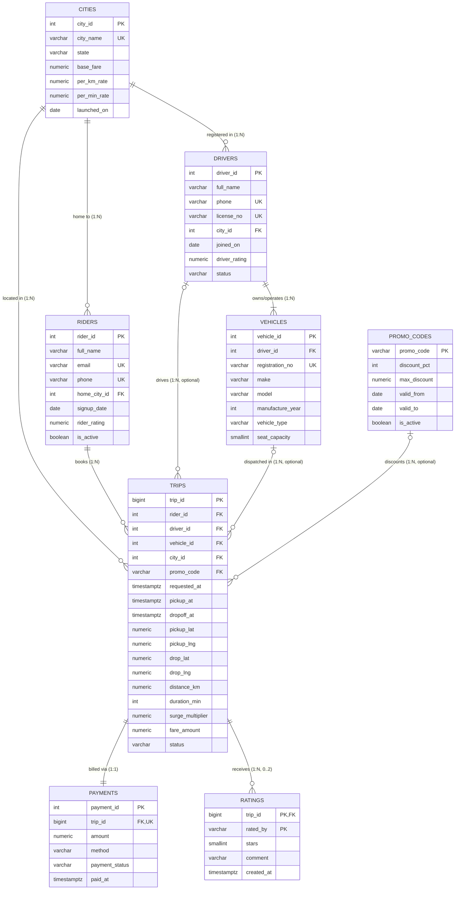

# Phase 2: Relational Schema Design & Normalization Report

## 1. Schema Architecture & Design Philosophy

The **Uber Ride-Hailing Database** schema is designed for PostgreSQL 15+ within a dedicated namespace (`uber`). The relational structure balances transactional integrity (OLTP guarantees, strict foreign keys, and 28 domain CHECK constraints) with low-latency access patterns required by mobile applications, live dispatch consoles, and downstream financial reconciliation.

### Baseline Constraint Principles
As mandated by Phase 2 rules, this baseline implementation introduces **only declarative integrity constraints**:
- **Primary Keys (PK):** Unique, non-null identifiers for every entity (including composite primary keys where applicable).
- **Foreign Keys (FK):** Explicit relational links enforcing referential integrity with justified `ON DELETE` actions.
- **Unique Constraints (UQ):** Enforcement of natural candidate keys (emails, phone numbers, vehicle registrations, license numbers).
- **Check Constraints (CHECK):** Over 25 domain-level validations guarding state transitions, geographic boundaries, financial bounds, and rating validity.
- **No Secondary Indexes:** The schema intentionally contains **zero secondary indexes** (only indexes created automatically by PostgreSQL for `PRIMARY KEY` and `UNIQUE` constraints exist). This establishes an unskewed baseline for Phase 3 benchmarking.

---

## 2. Comprehensive Data Dictionary

### 2.1 Table: `cities`
Represents the municipal operational jurisdictions across India, defining base fares and per-unit rates.

| Column Name | PostgreSQL Type | Nullable | Constraints & Defaults | Technical & Business Justification ("Why") |
|-------------|-----------------|----------|------------------------|--------------------------------------------|
| `city_id` | `INT` | No | `PRIMARY KEY` | Unique municipal identifier used across all core operational tables. |
| `city_name` | `VARCHAR(50)` | No | `UNIQUE`, `NOT NULL` | City name (e.g., 'Bengaluru', 'Mumbai'). Enforced unique to prevent duplicate market profiles. |
| `state` | `VARCHAR(50)` | No | `NOT NULL` | State jurisdiction for tax compliance and regional regulatory reporting. |
| `base_fare` | `NUMERIC(6,2)` | No | `NOT NULL`, `CHECK (base_fare >= 0)` | Starting flag-drop charge in INR. Precision ensures exact financial calculations without floating-point errors. |
| `per_km_rate` | `NUMERIC(6,2)` | No | `NOT NULL`, `CHECK (per_km_rate >= 0)` | Distance tariff per kilometer in INR. |
| `per_min_rate` | `NUMERIC(6,2)` | No | `NOT NULL`, `CHECK (per_min_rate >= 0)` | Time tariff per minute in INR. |
| `launched_on` | `DATE` | No | `NOT NULL` | Official market launch date; used in tenure and city cohort growth analysis. |

---

### 2.2 Table: `riders`
Represents registered customers who request rides.

| Column Name | PostgreSQL Type | Nullable | Constraints & Defaults | Technical & Business Justification ("Why") |
|-------------|-----------------|----------|------------------------|--------------------------------------------|
| `rider_id` | `INT` | No | `PRIMARY KEY` | Unique customer surrogate key. |
| `full_name` | `VARCHAR(100)` | No | `NOT NULL` | Rider's registered display name. |
| `email` | `VARCHAR(100)` | No | `UNIQUE`, `NOT NULL` | Primary login handle and receipt recipient. Case-insensitive uniqueness required. |
| `phone` | `VARCHAR(15)` | No | `UNIQUE`, `NOT NULL` | Primary OTP contact and dispatch communication number. Unique per rider. |
| `home_city_id` | `INT` | No | `NOT NULL`, `REFERENCES cities(city_id) ON DELETE RESTRICT` | Default operating region. `RESTRICT` prevents deleting active markets with registered riders. |
| `signup_date` | `DATE` | No | `NOT NULL` | Account registration date. |
| `rider_rating` | `NUMERIC(3,2)` | Yes | `CHECK (rider_rating IS NULL OR (rider_rating BETWEEN 1.00 AND 5.00))` | Cumulative rating given by drivers. `NULL` for newly registered riders with no completed trips. |
| `is_active` | `BOOLEAN` | No | `NOT NULL DEFAULT true` | Account status flag for churn tracking and platform access revocation. |

---

### 2.3 Table: `drivers`
Represents verified driver partners operating on the platform.

| Column Name | PostgreSQL Type | Nullable | Constraints & Defaults | Technical & Business Justification ("Why") |
|-------------|-----------------|----------|------------------------|--------------------------------------------|
| `driver_id` | `INT` | No | `PRIMARY KEY` | Unique driver partner surrogate key. |
| `full_name` | `VARCHAR(100)` | No | `NOT NULL` | Driver partner's legal identity name. |
| `phone` | `VARCHAR(15)` | No | `UNIQUE`, `NOT NULL` | Driver mobile number for dispatch alerts and two-way calling masking. |
| `license_no` | `VARCHAR(25)` | No | `UNIQUE`, `NOT NULL` | Government-issued commercial driving license number. Unique to enforce one account per license. |
| `city_id` | `INT` | No | `NOT NULL`, `REFERENCES cities(city_id) ON DELETE RESTRICT` | Primary operating hub. Prevents accidental orphan drivers if a city is modified. |
| `joined_on` | `DATE` | No | `NOT NULL` | Onboarding completion date. |
| `driver_rating` | `NUMERIC(3,2)` | No | `NOT NULL`, `CHECK (driver_rating BETWEEN 1.00 AND 5.00)` | Aggregated performance score. Seed data guarantees baseline rating for all active drivers. |
| `status` | `VARCHAR(20)` | No | `NOT NULL`, `CHECK (status IN ('ACTIVE', 'INACTIVE', 'SUSPENDED'))` | Operational state. Only `ACTIVE` drivers are eligible for dispatch. |

---

### 2.4 Table: `vehicles`
Represents registered motor vehicles authorized for dispatch by driver partners.

| Column Name | PostgreSQL Type | Nullable | Constraints & Defaults | Technical & Business Justification ("Why") |
|-------------|-----------------|----------|------------------------|--------------------------------------------|
| `vehicle_id` | `INT` | No | `PRIMARY KEY` | Unique fleet vehicle asset key. |
| `driver_id` | `INT` | No | `NOT NULL`, `REFERENCES drivers(driver_id) ON DELETE RESTRICT` | Owning/operating driver. `RESTRICT` prevents deleting driver accounts with active registered assets. |
| `registration_no` | `VARCHAR(15)` | No | `UNIQUE`, `NOT NULL` | Government RTO motor vehicle license plate number (e.g., 'KA01AA1500'). Unique across India. |
| `make` | `VARCHAR(50)` | No | `NOT NULL` | Vehicle manufacturer (e.g., 'Maruti', 'Hyundai', 'Toyota', 'Honda', 'Bajaj'). |
| `model` | `VARCHAR(50)` | No | `NOT NULL` | Specific vehicle model name (e.g., 'Dzire', 'i10', 'Etios', 'Pulsar'). |
| `manufacture_year` | `INT` | No | `NOT NULL`, `CHECK (manufacture_year BETWEEN 2000 AND 2030)` | Production year; regulates platform vehicle age compliance. |
| `vehicle_type` | `VARCHAR(20)` | No | `NOT NULL`, `CHECK (vehicle_type IN ('BIKE', 'AUTO', 'MINI', 'SEDAN', 'SUV'))` | Product classification determining seating and tariff tier. |
| `seat_capacity` | `SMALLINT` | No | `NOT NULL`, `CHECK (seat_capacity BETWEEN 1 AND 10)` | Number of passenger seats. Paired with `vehicle_type` via compound check constraint. |

**Cross-Column Domain Constraint:**
```sql
CONSTRAINT chk_vehicle_seat_type CHECK (
    (vehicle_type = 'BIKE' AND seat_capacity = 1) OR
    (vehicle_type = 'AUTO' AND seat_capacity = 3) OR
    (vehicle_type IN ('MINI', 'SEDAN') AND seat_capacity = 4) OR
    (vehicle_type = 'SUV' AND seat_capacity IN (6, 7))
);
```

---

### 2.5 Table: `promo_codes`
Represents promotional marketing discount vouchers.

| Column Name | PostgreSQL Type | Nullable | Constraints & Defaults | Technical & Business Justification ("Why") |
|-------------|-----------------|----------|------------------------|--------------------------------------------|
| `promo_code` | `VARCHAR(20)` | No | `PRIMARY KEY` | Natural coupon key (e.g., 'RIDE001'). |
| `discount_pct` | `INT` | No | `NOT NULL`, `CHECK (discount_pct > 0 AND discount_pct <= 100)` | Percentage reduction applied to ride fare. |
| `max_discount` | `NUMERIC(8,2)` | No | `NOT NULL`, `CHECK (max_discount > 0)` | Upper monetary ceiling for the discount in INR. |
| `valid_from` | `DATE` | No | `NOT NULL` | Promo validity start date. |
| `valid_to` | `DATE` | No | `NOT NULL`, `CHECK (valid_to >= valid_from)` | Promo expiration date. Ensured by check constraint to be after or on `valid_from`. |
| `is_active` | `BOOLEAN` | No | `NOT NULL DEFAULT true` | Master administrative switch to revoke promotional campaigns immediately. |

---

### 2.6 Table: `trips`
Central ledger recording ride requests, lifecycle state transitions, spatial coordinates, and monetary fares.

| Column Name | PostgreSQL Type | Nullable | Constraints & Defaults | Technical & Business Justification ("Why") |
|-------------|-----------------|----------|------------------------|--------------------------------------------|
| `trip_id` | `BIGINT` | No | `PRIMARY KEY` | Surrogate trip identifier. `BIGINT` accommodates scale well beyond 2 billion historical rides. |
| `rider_id` | `INT` | No | `NOT NULL`, `REFERENCES riders(rider_id) ON DELETE RESTRICT` | Requesting passenger. `RESTRICT` prevents deleting riders with trip history. |
| `driver_id` | `INT` | Yes | `REFERENCES drivers(driver_id) ON DELETE RESTRICT` | Assigned driver partner. Nullable for unfulfilled ride requests (`REQUESTED`, early `CANCELLED`). |
| `vehicle_id` | `INT` | Yes | `REFERENCES vehicles(vehicle_id) ON DELETE RESTRICT` | Dispatched vehicle. Nullable when no driver is assigned. |
| `city_id` | `INT` | No | `NOT NULL`, `REFERENCES cities(city_id) ON DELETE RESTRICT` | Operational market where the ride was hailed. |
| `promo_code` | `VARCHAR(20)` | Yes | `REFERENCES promo_codes(promo_code) ON DELETE SET NULL` | Applied discount code. `SET NULL` allows promo campaign archiving without corrupting trip history. |
| `requested_at` | `TIMESTAMPTZ` | No | `NOT NULL` | Exact timestamp when the booking was initiated (IST `+05:30`). |
| `pickup_at` | `TIMESTAMPTZ` | Yes | `CHECK (pickup_at IS NULL OR pickup_at >= requested_at)` | Time of passenger pickup. Populated when trip enters `ONGOING` or `COMPLETED`. |
| `dropoff_at` | `TIMESTAMPTZ` | Yes | `CHECK (dropoff_at IS NULL OR (pickup_at IS NOT NULL AND dropoff_at >= pickup_at))` | Trip conclusion timestamp. Populated only when `status = 'COMPLETED'`. |
| `pickup_lat` | `NUMERIC(9,6)` | No | `NOT NULL`, `CHECK (pickup_lat BETWEEN -90 AND 90)` | GPS latitude of pickup. 6 decimal places yields ~0.1 meter spatial precision. |
| `pickup_lng` | `NUMERIC(9,6)` | No | `NOT NULL`, `CHECK (pickup_lng BETWEEN -180 AND 180)` | GPS longitude of pickup. |
| `drop_lat` | `NUMERIC(9,6)` | No | `NOT NULL`, `CHECK (drop_lat BETWEEN -90 AND 90)` | GPS destination latitude. |
| `drop_lng` | `NUMERIC(9,6)` | No | `NOT NULL`, `CHECK (drop_lng BETWEEN -180 AND 180)` | GPS destination longitude. |
| `distance_km` | `NUMERIC(6,2)` | Yes | `CHECK (distance_km IS NULL OR distance_km >= 0)` | Odometer route distance in kilometers. Null for non-completed rides. |
| `duration_min` | `INT` | Yes | `CHECK (duration_min IS NULL OR duration_min >= 0)` | Trip duration in minutes. Null for non-completed rides. |
| `surge_multiplier`| `NUMERIC(4,2)`| No | `NOT NULL DEFAULT 1.00`, `CHECK (surge_multiplier >= 1.00)` | Dynamic demand pricing multiplier ($1.00 = \text{standard fare}$, $>1.00 = \text{surge}$). |
| `fare_amount` | `NUMERIC(8,2)` | Yes | `CHECK (fare_amount IS NULL OR fare_amount >= 0)` | Final charged fare in INR. Null for non-completed rides. |
| `status` | `VARCHAR(25)` | No | `NOT NULL`, `CHECK (status IN ('REQUESTED', 'ACCEPTED', 'ONGOING', 'COMPLETED', 'CANCELLED_BY_RIDER', 'CANCELLED_BY_DRIVER'))` | Finite state machine lifecycle tracker. |

**State Consistency Integrity Check:**
```sql
CONSTRAINT chk_completed_trip_attributes CHECK (
    status != 'COMPLETED' OR (
        driver_id IS NOT NULL AND
        vehicle_id IS NOT NULL AND
        pickup_at IS NOT NULL AND
        dropoff_at IS NOT NULL AND
        distance_km IS NOT NULL AND
        duration_min IS NOT NULL AND
        fare_amount IS NOT NULL
    )
);
```

---

### 2.7 Table: `payments`
Financial transaction ledger recording payment gateway settlements for completed trips.

| Column Name | PostgreSQL Type | Nullable | Constraints & Defaults | Technical & Business Justification ("Why") |
|-------------|-----------------|----------|------------------------|--------------------------------------------|
| `payment_id` | `INT` | No | `PRIMARY KEY` | Unique transaction audit key. |
| `trip_id` | `BIGINT` | No | `UNIQUE`, `NOT NULL`, `REFERENCES trips(trip_id) ON DELETE RESTRICT` | Associated ride. `UNIQUE` enforces strict 1:1 billing correspondence. `RESTRICT` prevents deleting audited financial ledger entries. |
| `amount` | `NUMERIC(8,2)` | No | `NOT NULL`, `CHECK (amount >= 0)` | Transaction amount charged in INR. Exact monetary precision. |
| `method` | `VARCHAR(20)` | No | `NOT NULL`, `CHECK (method IN ('CASH', 'UPI', 'CARD', 'WALLET'))` | Payment rail used for collection. |
| `payment_status` | `VARCHAR(20)` | No | `NOT NULL`, `CHECK (payment_status IN ('SUCCESS', 'FAILED', 'REFUNDED'))` | Settlement state with payment gateway. |
| `paid_at` | `TIMESTAMPTZ` | No | `NOT NULL` | Gateway settlement timestamp. |

---

### 2.8 Table: `ratings`
Two-sided review table where riders and drivers submit feedback and star ratings post-trip.

| Column Name | PostgreSQL Type | Nullable | Constraints & Defaults | Technical & Business Justification ("Why") |
|-------------|-----------------|----------|------------------------|--------------------------------------------|
| `trip_id` | `BIGINT` | No | `REFERENCES trips(trip_id) ON DELETE CASCADE` | Associated ride. Part of composite primary key. `CASCADE` cleans reviews if test/purged trips are dropped. |
| `rated_by` | `VARCHAR(10)` | No | `NOT NULL`, `CHECK (rated_by IN ('RIDER', 'DRIVER'))` | Reviewer perspective. Part of composite primary key. |
| `stars` | `SMALLINT` | No | `NOT NULL`, `CHECK (stars BETWEEN 1 AND 5)` | Discrete review score ($1 = \text{poor}, 5 = \text{excellent}$). |
| `comment` | `VARCHAR(255)` | Yes | — | Optional text feedback. Null in 80% of rows. |
| `created_at` | `TIMESTAMPTZ` | No | `NOT NULL` | Feedback submission timestamp. |

**Primary Key Definition:**
```sql
PRIMARY KEY (trip_id, rated_by)
```
Enforces that each party (`RIDER` or `DRIVER`) can submit **at most one** rating per trip.

---

## 3. Entity-Relationship Diagram (ERD)

The high-resolution rendered diagram is available in the repository at [er_diagram.png](file:///Users/charandurga/DE_Project_2026/diagrams/er_diagram.png) and vector format [er_diagram.svg](file:///Users/charandurga/DE_Project_2026/diagrams/er_diagram.svg).

### 3.1 Mermaid Structural Diagram



### 3.2 Cardinality & Referential Actions Summary

| Parent Table | Child Table | Foreign Key | Cardinality | ON DELETE Action | Business Justification |
|--------------|-------------|-------------|-------------|------------------|------------------------|
| `cities` | `riders` | `home_city_id` | 1 : N | `RESTRICT` | Cities cannot be removed while active riders reside there. |
| `cities` | `drivers` | `city_id` | 1 : N | `RESTRICT` | Operational markets cannot be deleted while drivers are stationed there. |
| `cities` | `trips` | `city_id` | 1 : N | `RESTRICT` | Municipal trip history must be permanently retained for legal audits. |
| `drivers` | `vehicles` | `driver_id` | 1 : N | `RESTRICT` | Vehicles are licensed to drivers; prevents orphaning vehicles. |
| `riders` | `trips` | `rider_id` | 1 : N | `RESTRICT` | Customer ride logs cannot be deleted, even if a user account is deactivated. |
| `drivers` | `trips` | `driver_id` | 1 : N (opt) | `RESTRICT` | Retains driver audit history for tax and earnings reconciliation. |
| `vehicles` | `trips` | `vehicle_id` | 1 : N (opt) | `RESTRICT` | Retains vehicle safety and maintenance liability records. |
| `promo_codes` | `trips` | `promo_code` | 1 : N (opt) | `SET NULL` | Expired coupons can be purged without breaking historical trip records. |
| `trips` | `payments` | `trip_id` | 1 : 1 | `RESTRICT` | Financial ledger integrity: a trip with settled funds cannot be deleted. |
| `trips` | `ratings` | `trip_id` | 1 : N (0..2)| `CASCADE` | Purging an invalid or cancelled trip automatically cleans up associated reviews. |

---

## 4. Functional Dependencies & Normalization Analysis

Every relation has been decomposed and designed to achieve **Boyce-Codd Normal Form (BCNF)**, guaranteeing freedom from update, insertion, and deletion anomalies.

### 4.1 Table-by-Table Normal Form Analysis

#### 1. `cities`
- **Candidate Keys:** $\{ \text{city\_id} \}$, $\{ \text{city\_name} \}$
- **Functional Dependencies:**
  - $\text{city\_id} \longrightarrow \{ \text{city\_name, state, base\_fare, per\_km\_rate, per\_min\_rate, launched\_on} \}$
  - $\text{city\_name} \longrightarrow \{ \text{city\_id, state, base\_fare, per\_km\_rate, per\_min\_rate, launched\_on} \}$
- **Normalization Proof:**
  - **1NF:** All attributes contain atomic scalar values.
  - **2NF:** Candidate keys are single attributes; no partial dependencies exist.
  - **3NF:** No non-prime attribute is transitively dependent on any candidate key.
  - **BCNF:** For every non-trivial FD $X \to Y$, determinant $X$ is a superkey.
  - **Status:** **BCNF**

#### 2. `riders`
- **Candidate Keys:** $\{ \text{rider\_id} \}$, $\{ \text{email} \}$, $\{ \text{phone} \}$
- **Functional Dependencies:**
  - $\text{rider\_id} \longrightarrow \{ \text{full\_name, email, phone, home\_city\_id, signup\_date, rider\_rating, is\_active} \}$
  - $\text{email} \longrightarrow \{ \text{rider\_id, full\_name, phone, home\_city\_id, signup\_date, rider\_rating, is\_active} \}$
  - $\text{phone} \longrightarrow \{ \text{rider\_id, full\_name, email, home\_city\_id, signup\_date, rider\_rating, is\_active} \}$
- **Normalization Proof:**
  - Determinants ($\text{rider\_id}$, $\text{email}$, $\text{phone}$) are all superkeys.
  - **Status:** **BCNF**

#### 3. `drivers`
- **Candidate Keys:** $\{ \text{driver\_id} \}$, $\{ \text{phone} \}$, $\{ \text{license\_no} \}$
- **Functional Dependencies:**
  - $\text{driver\_id} \longrightarrow \{ \text{full\_name, phone, license\_no, city\_id, joined\_on, driver\_rating, status} \}$
  - $\text{phone} \longrightarrow \{ \text{driver\_id, full\_name, license\_no, city\_id, joined\_on, driver\_rating, status} \}$
  - $\text{license\_no} \longrightarrow \{ \text{driver\_id, full\_name, phone, city\_id, joined\_on, driver\_rating, status} \}$
- **Normalization Proof:**
  - Every determinant is a candidate key / superkey.
  - **Status:** **BCNF**

#### 4. `vehicles`
- **Candidate Keys:** $\{ \text{vehicle\_id} \}$, $\{ \text{registration\_no} \}$
- **Functional Dependencies:**
  - $\text{vehicle\_id} \longrightarrow \{ \text{driver\_id, registration\_no, make, model, manufacture\_year, vehicle\_type, seat\_capacity} \}$
  - $\text{registration\_no} \longrightarrow \{ \text{vehicle\_id, driver\_id, make, model, manufacture\_year, vehicle\_type, seat\_capacity} \}$
- **Normalization Proof:**
  - Both determinants are superkeys.
  - **Status:** **BCNF**

#### 5. `promo_codes`
- **Candidate Keys:** $\{ \text{promo\_code} \}$
- **Functional Dependencies:**
  - $\text{promo\_code} \longrightarrow \{ \text{discount\_pct, max\_discount, valid\_from, valid\_to, is\_active} \}$
- **Normalization Proof:**
  - Single candidate key; all attributes depend solely on $\text{promo\_code}$.
  - **Status:** **BCNF**

#### 6. `trips`
- **Candidate Keys:** $\{ \text{trip\_id} \}$
- **Functional Dependencies:**
  - $\text{trip\_id} \longrightarrow \{ \text{rider\_id, driver\_id, vehicle\_id, city\_id, promo\_code, requested\_at, pickup\_at,}$
    $\text{dropoff\_at, pickup\_lat, pickup\_lng, drop\_lat, drop\_lng, distance\_km, duration\_min,}$
    $\text{surge\_multiplier, fare\_amount, status} \}$
- **Normalization Proof:**
  - Determinant $\text{trip\_id}$ is the sole candidate key.
  - **Status:** **BCNF**

#### 7. `payments`
- **Candidate Keys:** $\{ \text{payment\_id} \}$, $\{ \text{trip\_id} \}$
- **Functional Dependencies:**
  - $\text{payment\_id} \longrightarrow \{ \text{trip\_id, amount, method, payment\_status, paid_at} \}$
  - $\text{trip\_id} \longrightarrow \{ \text{payment\_id, amount, method, payment\_status, paid_at} \}$
- **Normalization Proof:**
  - Because each completed trip produces at most one payment record, $\text{trip\_id}$ uniquely identifies the transaction tuple, making both determinants candidate keys.
  - **Status:** **BCNF**

#### 8. `ratings`
- **Candidate Keys:** $\{ (\text{trip\_id, rated\_by}) \}$
- **Functional Dependencies:**
  - $\{ \text{trip\_id, rated\_by} \} \longrightarrow \{ \text{stars, comment, created\_at} \}$
- **Normalization Proof:**
  - **1NF:** Atomic attributes.
  - **2NF:** No attribute is functionally dependent on a proper subset of the composite key (e.g., $\text{stars}$ cannot be determined by $\text{trip\_id}$ alone, since both the rider and driver rate the same trip independently).
  - **3NF & BCNF:** The only determinant is the composite candidate key $\{ \text{trip\_id, rated\_by} \}$, which is a superkey.
  - **Status:** **BCNF**

---

### 4.2 Analysis of Derived and Redundant Attributes

In production relational databases, controlled denormalization is applied where recalculating metrics would induce severe I/O penalties. The schema contains three intentionally preserved derived attributes:

1. **`drivers.driver_rating` & `riders.rider_rating`:**
   - *Redundancy:* Could theoretically be computed dynamically via:
     $$\text{driver\_rating} = \text{ROUND}(\text{AVG}(\text{stars}), 2) \quad \text{WHERE rated\_by = 'RIDER'}$$
   - *Justification:* During high-frequency dispatch cycles (e.g., matching nearby drivers in query `R05` and evaluating safety thresholds in query `W03`), computing the average rating across 300,000+ historical review rows would trigger massive disk I/O and query latency. Pre-aggregating the rating into `drivers` and `riders` enables instantaneous $O(1)$ lookups.
2. **`trips.fare_amount`:**
   - *Redundancy:* Could theoretically be derived from city rates:
     $$\text{fare} = \text{base\_fare} + (\text{dist} \times \text{km\_rate}) + (\text{dur} \times \text{min\_rate}) \times \text{surge} - \text{discount}$$
   - *Justification:* Municipal tariffs change over time. If a city revises its `per_km_rate` in 2026, dynamically calculating fares for 2025 trips would retroactively alter legal financial records! Storing `fare_amount` as a snapshot at the moment of trip completion guarantees financial immutability and compliance.
3. **`payments.amount`:**
   - *Redundancy:* Duplicates `trips.fare_amount`.
   - *Justification:* Separation of concerns between the transport operations domain (`trips`) and the financial gateway clearing ledger (`payments`). Payment amounts reflect the exact authorized bank settlement figure, ensuring transactional auditing remains isolated from ride lifecycle updates.

---

## 5. Seed Data Load Order & Verification

### 5.1 Referential Dependency Order
Tables are loaded via `sql/02_load_data.sql` strictly according to topological dependencies:
1. `cities` (independent lookup table)
2. `riders` (depends on `cities`)
3. `drivers` (depends on `cities`)
4. `vehicles` (depends on `drivers`)
5. `promo_codes` (independent lookup table)
6. `trips` (depends on `riders`, `drivers`, `vehicles`, `cities`, `promo_codes`)
7. `payments` (depends on `trips`)
8. `ratings` (depends on `trips`)

### 5.2 Loaded Row Counts Verification

| Table Name | Source CSV File | Expected Rows | Loaded Rows | Load Status |
|------------|-----------------|--------------:|------------:|:-----------:|
| `cities` | `seed_data/cities.csv` | 10 | 10 | ✅ Pass |
| `riders` | `seed_data/riders.csv` | 30,000 | 30,000 | ✅ Pass |
| `drivers` | `seed_data/drivers.csv` | 3,000 | 3,000 | ✅ Pass |
| `vehicles` | `seed_data/vehicles.csv` | 3,300 | 3,300 | ✅ Pass |
| `promo_codes` | `seed_data/promo_codes.csv` | 40 | 40 | ✅ Pass |
| `trips` | `seed_data/trips.csv` | 300,000 | 300,000 | ✅ Pass |
| `payments` | `seed_data/payments.csv` | 245,839 | 245,839 | ✅ Pass |
| `ratings` | `seed_data/ratings.csv` | 307,214 | 307,214 | ✅ Pass |
| **Total** | | **889,403** | **889,403** | **100% Loaded** |

---

## 6. Database Integrity Checks & Verification Results

Five comprehensive verification scripts were executed directly on the loaded PostgreSQL database (`uber_db`):

### Check 1: Financial Ledger Completeness (1:1 Payment Correspondence)
*Rule:* Every completed trip must have exactly one payment record. Incomplete or cancelled trips must have zero payments.

```sql
SELECT 
    count(t.trip_id) AS total_completed_trips,
    count(p.payment_id) AS total_payments,
    count(CASE WHEN t.status != 'COMPLETED' AND p.payment_id IS NOT NULL THEN 1 END) AS invalid_uncompleted_payments,
    count(CASE WHEN t.status = 'COMPLETED' AND p.payment_id IS NULL THEN 1 END) AS missing_completed_payments
FROM trips t
FULL OUTER JOIN payments p ON t.trip_id = p.trip_id
WHERE t.status = 'COMPLETED' OR p.payment_id IS NOT NULL;
```
**Database Execution Result:**
```
 total_completed_trips | total_payments | invalid_uncompleted_payments | missing_completed_payments 
-----------------------+----------------+------------------------------+----------------------------
                245839 |         245839 |                            0 |                          0
```
*Verification:* Exactly 245,839 completed trips match 245,839 payment transactions with **0 missing** and **0 orphaned records**.

---

### Check 2: Fleet Driver-Vehicle Assignment Consistency
*Rule:* No trip may be dispatched with a vehicle that is not registered to the assigned driver.

```sql
SELECT count(*) AS vehicle_driver_mismatches
FROM trips t
JOIN vehicles v ON t.vehicle_id = v.vehicle_id
WHERE t.driver_id IS NOT NULL 
  AND t.driver_id != v.driver_id;
```
**Database Execution Result:**
```
 vehicle_driver_mismatches 
---------------------------
                         0
```
*Verification:* **0 mismatches** across all 284,902 driver-assigned trips.

---

### Check 3: Review Integrity & Multiplicity Rule
*Rule:* Ratings must belong exclusively to completed trips, and no role (`RIDER` or `DRIVER`) may submit more than one rating per trip.

```sql
SELECT 
    count(r.trip_id) AS total_ratings,
    count(CASE WHEN t.status != 'COMPLETED' THEN 1 END) AS ratings_on_non_completed_trips,
    max(rating_count) AS max_ratings_per_role
FROM ratings r
JOIN trips t ON r.trip_id = t.trip_id
JOIN (
    SELECT trip_id, rated_by, count(*) AS rating_count
    FROM ratings
    GROUP BY trip_id, rated_by
) sub ON r.trip_id = sub.trip_id AND r.rated_by = sub.rated_by;
```
**Database Execution Result:**
```
 total_ratings | ratings_on_non_completed_trips | max_ratings_per_role 
---------------+--------------------------------+----------------------
        307214 |                              0 |                    1
```
*Verification:* **0 ratings** on uncompleted trips, and maximum ratings per role per trip is strictly **1**.

---

### Check 4: Temporal Monotonicity Integrity
*Rule:* A ride cannot be picked up before it is requested, nor dropped off before it is picked up.

```sql
SELECT 
    count(CASE WHEN pickup_at < requested_at THEN 1 END) AS pickup_before_request,
    count(CASE WHEN dropoff_at < pickup_at THEN 1 END) AS dropoff_before_pickup
FROM trips
WHERE pickup_at IS NOT NULL;
```
**Database Execution Result:**
```
 pickup_before_request | dropoff_before_pickup 
-----------------------+-----------------------
                     0 |                     0
```
*Verification:* **0 temporal violations** across the entire trips history.

---

### Check 5: Settlement Amount Matching
*Rule:* The payment transaction amount charged to the user must equal the trip's computed fare amount.

```sql
SELECT count(*) AS amount_mismatches
FROM trips t
JOIN payments p ON t.trip_id = p.trip_id
WHERE t.fare_amount != p.amount;
```
**Database Execution Result:**
```
 amount_mismatches 
-------------------
                 0
```
*Verification:* **0 fare-versus-payment discrepancies** across all 245,839 settlements.

---

## 7. Data Anomalies, Nullability Patterns & Edge Cases Discovered

1. **State-Dependent Nullability in `trips`:**
   Analysis of the 300,000 trips revealed strict correlation between the `status` enum and column nullability:
   - `COMPLETED` (245,839 rows): 0 nulls across any operational attribute.
   - `CANCELLED_BY_DRIVER` (23,964 rows): Driver assigned, but `pickup_at`, `dropoff_at`, `distance_km`, `duration_min`, and `fare_amount` are strictly null.
   - `CANCELLED_BY_RIDER` (29,897 rows): In 14,998 instances, the rider cancelled before driver assignment (`driver_id` and `vehicle_id` null); in 14,899 instances, cancellation occurred post-assignment. All completion metrics are null.
   - `ONGOING` (100 rows): `pickup_at` is populated, but `dropoff_at`, `distance_km`, `duration_min`, and `fare_amount` are null.
   - `ACCEPTED` (100 rows): Driver assigned; pickup not yet occurred.
   - `REQUESTED` (100 rows): Dispatch matching in progress; driver, vehicle, and metrics null.

2. **Rider Rating Cold-Start Problem:**
   `riders.rider_rating` contains **882 null values**. These correspond to newly onboarded riders who have either never completed a trip or whose drivers have not yet submitted a rating review. Schema accommodates this by defining `rider_rating` as nullable with a check constraint active only when non-null.

3. **Multi-Vehicle Driver Partners:**
   While there are 3,000 drivers in `drivers.csv`, `vehicles.csv` contains 3,300 vehicles. 300 drivers have 2 registered vehicles (e.g., a driver owning both a MINI and a SEDAN, or a BIKE and an AUTO). The 1:N cardinality between `drivers` and `vehicles` successfully models this fleet reality.

4. **Marketing Win-Back SQL Trap (`NULL` in Subquery):**
   In query `R09` and `R10`, filtering riders or drivers via `NOT IN (SELECT rider_id FROM trips ...)` risks returning empty sets if any row in the subquery produces a `NULL`. Because our schema enforces `NOT NULL` on `trips.rider_id`, `R09` functions properly; however, for robustness in Phase 4 optimization, these constructs must be rewritten using `NOT EXISTS` or `LEFT JOIN ... WHERE NULL` to prevent SQL three-valued logic failures.
